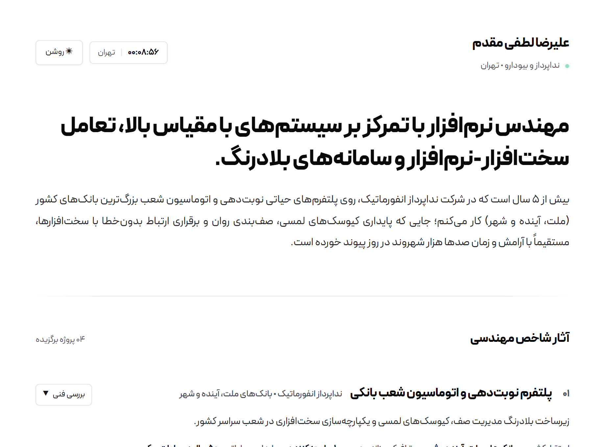
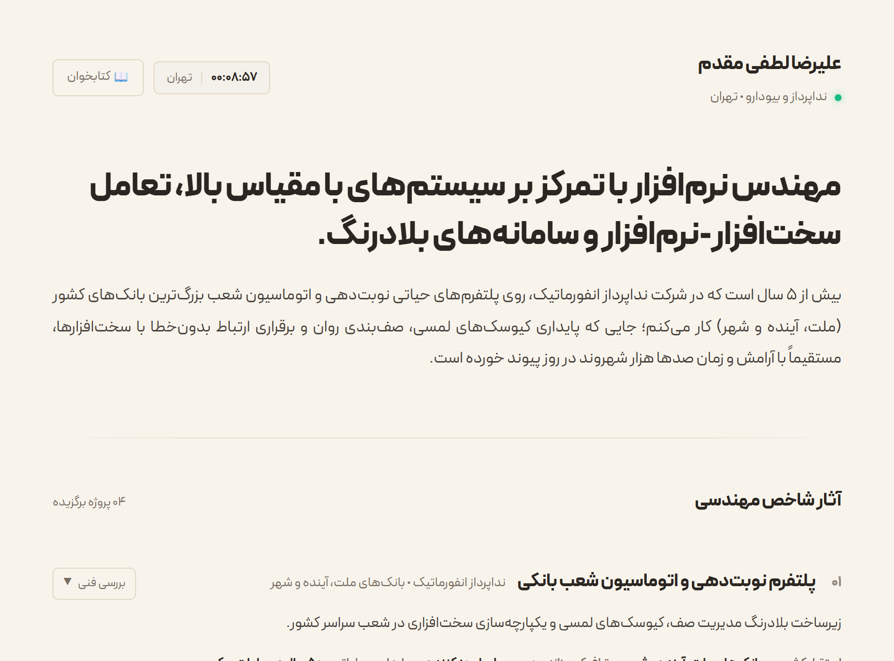
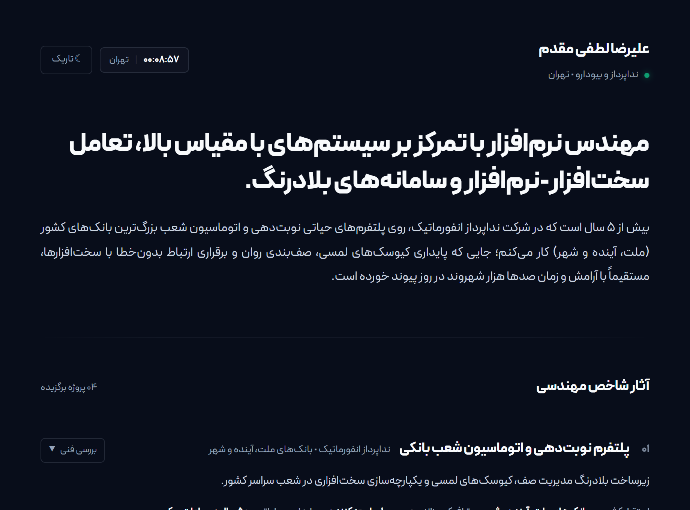
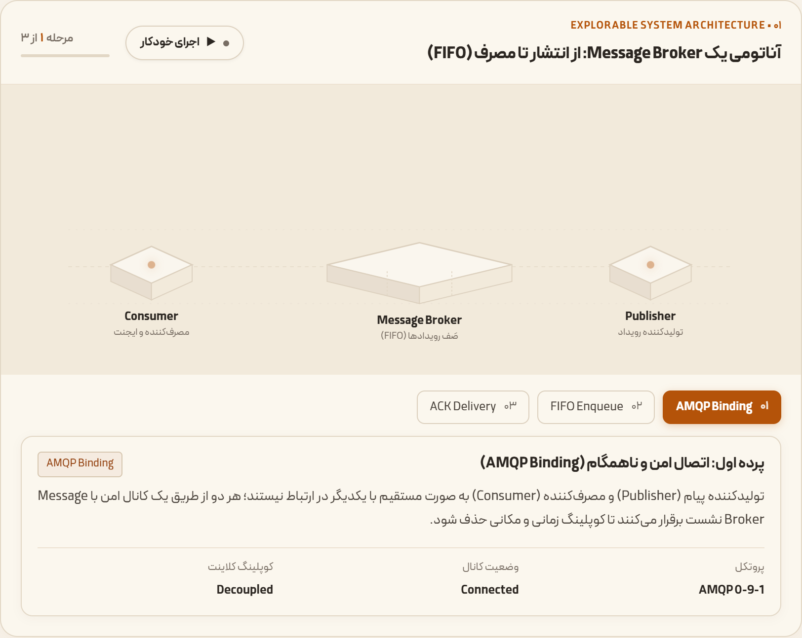
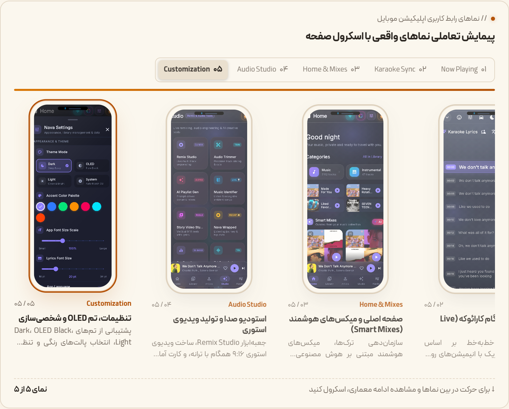

# 🌲 Alireza Lotfi Moghaddam — Portfolio & Engineering Showcase (v4.0.1)

[](package.json)
[](https://vuejs.org/)
[](https://vitejs.dev/)
[](https://dotnet.microsoft.com/)
[](https://fontiran.com/)
[](LICENSE)
[](https://alirezalotfimoghaddam.ir/)

> **High-Craft Swiss Editorial Portfolio & Explorable Systems Showcase.**  
> A performance-oriented personal website crafted for a .NET systems & backend engineer. Features an editorial Swiss Minimalist layout, a 3-way tactile theme system (Dark / Light / Warm Paper), an explorable isometric message broker simulation, scroll-driven RTL smartphone showcase, procedural Web Audio micro-synth, and an automated Jamstack SSG pipeline.

---

## 🎨 Tri-Theme Experience (سیستم تم سه‌گانه)

The portfolio introduces a curated 3-way theme system tailored for different lighting environments and reading ergonomics:

| ☀️ **Swiss Minimalist Light** | 📖 **Fidibo Warm Paper (کتاب‌خوان)** | 🌙 **Space Obsidian Dark** |
| :---: | :---: | :---: |
| [](./docs/screenshots/theme-light.png) | [](./docs/screenshots/theme-paper.png) | [](./docs/screenshots/theme-dark.png) |
| Crisp high-contrast white & slate ink | Ergonomic warm parchment (`#f8f4ec`) & organic terracotta | Deep obsidian space glass with cyan telemetry |

- **☀️ Swiss Minimalist Light:** Ultra-clean editorial contrast, black ink on pure white paper, refined micro-borders (`#e4e4e7`).
- **📖 Fidibo Warm Paper (Book-Reader):** Inspired by e-readers and physical book publishing. Reduces eye fatigue with warm parchment tones (`#f8f4ec`), deep charcoal ink (`#2b2621`), terracotta amber accents (`#b45309`), and muted editorial badges.
- **🌙 Space Obsidian Dark:** Immersive deep space obsidian (`#080d1a`), subtle frosted glass surfaces, and glowing cyan telemetry indicators.
- **🔊 Tactile Feedback:** Each theme toggle triggers a distinct procedural harmonic audio chirp synthesized in real-time via Web Audio API.

---

## 🚀 Key Engineering Showcases

### 1. ⚙️ Explorable Message Broker Architecture (آناتومی پیام‌رسان توزیع‌شده)
An interactive isometric diagram visualizing the lifecycle of an asynchronous event-driven system from Producer to Exchange, Queue, Worker Consumer, and Ack confirmation.

[](./docs/screenshots/message-broker-paper.png)

- **Interactive Stage Scrollytelling:** Step-by-step synchronization tied directly to scroll depth and interactive pill steppers.
- **Auto-Play Simulation Engine:** One-click automated walk-through demonstrating FIFO packet delivery with live progress tracking and state retention.
- **Theme-Adaptive Engineering Art:** Switches dynamically between digital neon glass and authentic library technical schematic styling.

### 2. 📱 Nava Music Player: Scroll-Driven RTL Phone Showcase (گالری نماهای واقعی)
A realistic scroll-driven smartphone exhibition presenting real application screenshots of the cross-platform **Nava** player.

[](./docs/screenshots/nava-gallery-rtl.png)

- **Strict Persian RTL Kinematics:** Engineered with Right-to-Left coordinate translation (`progress * maxOverflow`), centering Slide ۰۱ naturally on the right.
- **Mobile Touch Swipe Engine:** 1:1 fluid swipe gesture support on iOS & Android viewports.
- **Fullscreen High-Resolution Lightbox:** Keyboard-navigable (`Escape`, Arrow keys) deep-dive inspection modal.

---

## 🌟 Architectural Highlights

- **Swiss Minimalist Layout (`CraftMinimalLayout.vue`):** Rebuilt from the ground up for maximum visual clarity, typography hierarchy, and effortless scanning.
- **Focus Dimming & Spotlight Hover:** When hovering over any flagship project, sibling rows gracefully dim (`opacity: 0.38`), creating an effortless reading spotlight.
- **Floating TOC Reading Rail:** Persistent side navigation rail with reading progress indication, quick section jumping, and scroll-to-top shortcut.
- **Command Palette (`Ctrl + K` / `Cmd + K`):** Raycast-style spotlight search for instant navigation across projects, experience, skills, and notes.
- **Developer CLI Terminal (`TerminalModal.vue`):** Interactive terminal emulator with command history, auto-completion, and utilities (`help`, `neofetch`, `matrix`, `projects`).
- **Zero-Asset Web Audio Synth (`useAudioSynth.js`):** 0 KB audio files. All interactive clicks, chimes, and theme switches are synthesized procedurally via the browser's native `AudioContext`.
- **Jamstack SSG & SEO Engine:** Automated post-build pre-renderer generating 17 crawlable static HTML routes with OpenGraph metadata, JSON-LD structured schema, and automated `sitemap.xml`.
- **Offline-First PWA:** Service Worker caching strategy with offline fallback and asset versioning.

---

## 📂 Project Structure

```plaintext
├── docs/
│   └── screenshots/       # High-resolution documentation screenshots
├── public/
│   ├── dynamicData/       # Decoupled JSON data (projects, experience, notes, skills)
│   ├── projects/          # Curated showcase assets & screenshots
│   ├── manifest.json      # PWA application manifest
│   ├── sitemap.xml        # Auto-generated search engine sitemap
│   └── sw.js              # Offline caching service worker
├── scripts/
│   └── generate-static-pages.mjs  # Post-build SSG pre-renderer (17 static routes)
├── src/
│   ├── components/
│   │   ├── dashboard/
│   │   │   ├── CraftMinimalLayout.vue        # v4.0.0 Primary Swiss Editorial Layout
│   │   │   ├── InteractiveMessageBroker.vue  # Explorable isometric architecture stage
│   │   │   ├── EditorialHeader.vue           # Responsive masthead & theme switcher
│   │   │   └── CommandPaletteModal.vue       # Raycast-style quick search modal
│   │   ├── LiquidIdentityCard.vue            # Hero procedural identity card
│   │   ├── TerminalModal.vue                 # Interactive CLI terminal
│   │   ├── MatrixRain.vue                    # Ambient matrix canvas effect
│   │   ├── CustomCursor.vue                  # Tactile magnetic cursor
│   │   └── PrintResumeView.vue               # Printable A4 resume view
│   ├── composables/
│   │   ├── useTheme.js                       # 3-way theme state & token controller
│   │   ├── useAudioSynth.js                  # Zero-asset procedural sound engine
│   │   ├── usePortfolio.js                   # Reactive data store
│   │   └── useSEO.js                         # Dynamic metadata & JSON-LD
│   ├── App.vue                               # Root application shell
│   └── style.css                             # Global tokens, Peyda Variable & reset
├── vite.config.js                            # Vite configuration & build pipeline
└── package.json                              # v4.0.0 dependencies & scripts
```

---

## 🛠️ Quick Start

```bash
# Clone the repository
git clone https://github.com/AlirezaLotfiM/AlirezaLotfiM.github.io.git
cd AlirezaLotfiM.github.io

# Install dependencies
npm install

# Start local dev server (port 5173)
npm run dev

# Build for production & generate static SSG pages
npm run build

# Deploy latest build to GitHub Pages (gh-pages branch)
npm run deploy
```

---

## ⌨️ Keyboard Shortcuts

| Shortcut | Action |
| :--- | :--- |
| `Ctrl + K` / `Cmd + K` | Open Command Palette / Spotlight Search |
| `Esc` | Close active modal, terminal, or lightbox |
| `←` / `→` | Navigate slides inside the image lightbox |
| `Tab` | Auto-complete command in Terminal CLI |
| `↑` / `↓` | History traversal in Terminal CLI |

---

## 👤 Author

**Alireza Lotfi Moghaddam (Damoon)**  
*Software & Systems Engineer (.NET 9 / ASP.NET Core / C# / WPF / Event-Driven Architectures)*

- 🌐 Website: [alirezalotfimoghaddam.ir](https://alirezalotfimoghaddam.ir)
- 🐙 GitHub: [@AlirezaLotfiM](https://github.com/AlirezaLotfiM)
- 💼 LinkedIn: [alireza-lotfi-moghaddam](https://linkedin.com/in/alireza-lotfi-moghaddam-378a8018a)
- ✉️ Email: `hi@alirz.ir`

---

## 📄 License

This project is open-source and available under the [MIT License](LICENSE).
